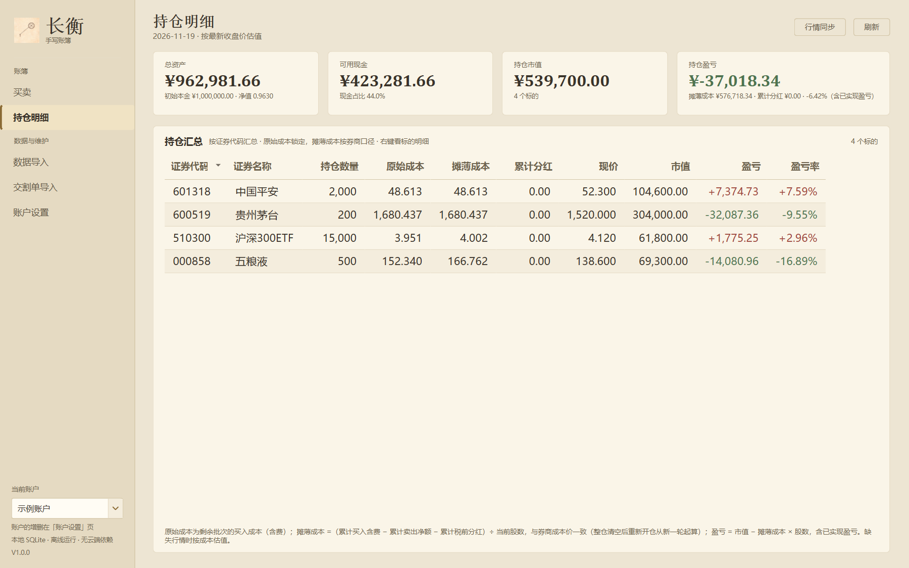
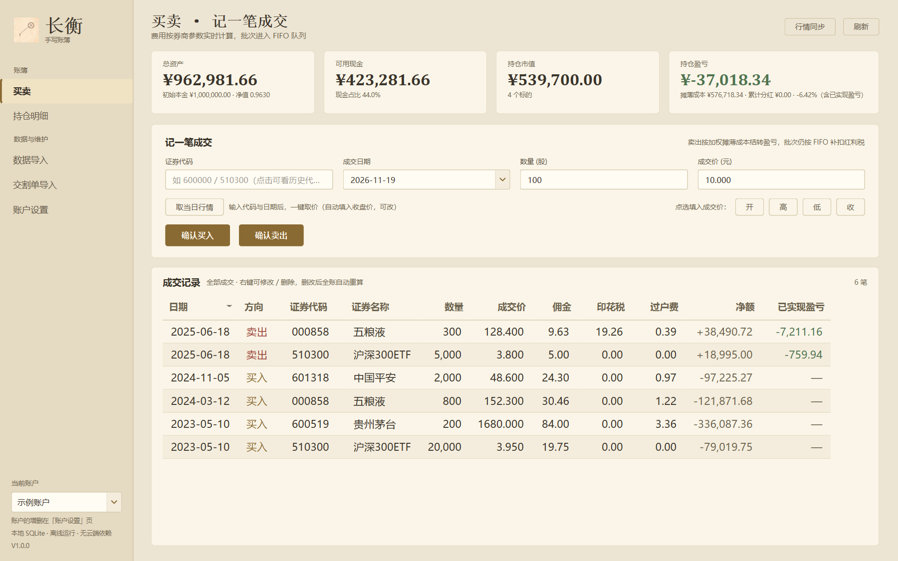
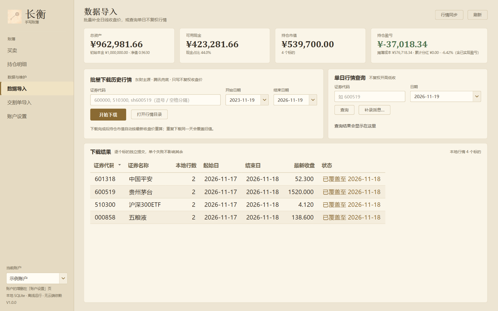
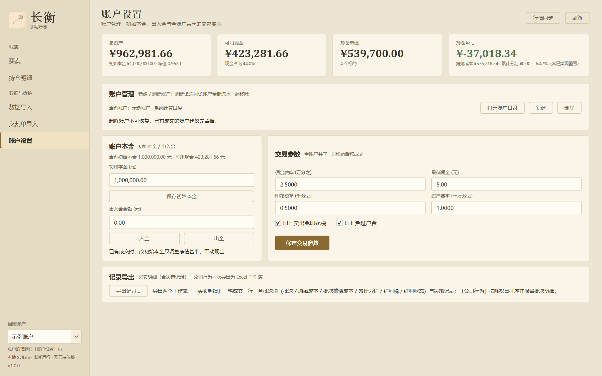

# 长衡

一本讲真话的个人投资账本。

长衡面向 A 股与 ETF 的长期投资者，把真实交易中容易被模拟盘忽略的摩擦成本完整记下来：佣金保底、卖出印花税、双边过户费、ETF 免税、红利税按持股期限补扣、送转后的成本摊薄与碎股补偿。它不追求撮合速度，只追求一件事——账面上的数字，和券商 App 对得上。

> 单机运行，数据只留在自己的电脑里。没有账号，没有云端，没有遥测。

---

## 为什么需要它

常见模拟盘和记账表的问题：

- 佣金写死，不认「最低 5 元保底」，小额定投的收益被高估
- 分红只记现金，不区分持股期限，红利税要么不收、要么一刀切
- 送转之后成本与市值对不上，除权日净值出现断层
- 无法回放历史行情，也没法用官方除权价校验自己的账

长衡用批次账本记录每一笔买入，按真实规则计算费用、分红与税，并守住一条底线：

```text
除权前总资产 = 除权后市值 + 派现 + 碎股补偿
```

---

## 主要能力

- **多账户**：每个账户独立的现金、持仓、流水与净值，互不干扰
- **真实费用**：佣金费率与最低保底、卖出印花税、双边过户费、ETF 自动识别与免征
- **批次持仓**：每笔买入独立成批，卖出逐批消耗，成本与盈亏有据可查
- **两种成本视角**：既保留原始买入成本，也给出券商口径的摊薄成本，持仓盈亏与券商 App 一致
- **分红与红利税**：红利按持股期限判定免税或待缴，跨过一年自动转为免税，卖出时按届时档位补扣
- **送转股**：按批次比例摊薄成本，碎股折现补偿，内置守恒校验
- **净值与收益**：每日快照、净值曲线、年化收益与最大回撤
- **行情管理**：一键下载 A 股 / ETF 历史日线，支持全历史回溯，失败标的互不影响
- **公司行为同步**：买入卖出、行情同步时自动拉取分红送转并落账；数据源缺失时可手动补录
- **交割单导入**：直接导入券商导出的 CSV / Excel，自动识别列名、隔离非交易记录，支持增量更新与资金余额对账
- **交易决策记录**：下单时可顺手记下买卖逻辑、计划内外、预期持有周期；不填也不影响入账，日后回看有据可依
- **记录导出**：按日期范围导出买卖明细（含批次与决策）与公司行为，方便归档或复盘

---

## 界面

纸质账簿的视觉风格：左侧导航分为「账簿」与「数据与维护」，顶部一屏看清总资产、现金、市值与持仓盈亏；持仓、成交、公司行为都以表格呈现，支持排序、列宽调整与右键修改。

- 买卖合一：输入代码和日期即可取当日行情，价格一键填入，提交前可顺手填写交易决策
- 持仓明细：右键任意标的查看完整流水、批次成本、分红与决策记录
- 数据导入：批量下载历史行情、查询单日行情、补录派息
- 交割单导入：先预览清洗结果，确认后再入账，支持重复导入自动去重
- 账户设置：账户管理、初始本金、出入金、费率设置与记录导出

**持仓明细**：原始成本与券商口径的摊薄成本并列，盈亏一目了然。



**买卖与成交记录**：买卖合一录入，成交后的费用、净额与已实现盈亏即时回算。



**数据导入**：批量下载历史行情，下载结果按标的展示本地覆盖情况。



**账户设置**：账户管理、本金与出入金、全账户共享费率，以及记录导出。



---

## 数据与隐私

- 所有数据保存在本机，不上传任何服务器
- 账户数据与行情数据分开存放，安装时可自行选择目录，便于备份与迁移
- 备份方式就是复制数据文件；卸载软件不会删除账本
- 不需要注册，不联网也能查看已有账本

---

## 适合谁

- 长期持有 A 股 / ETF，想认真记录每一笔成本与分红的个人投资者
- 用券商交割单复盘，希望账本与券商对得上的人
- 在意数据隐私，不愿意把持仓交给云端记账工具的人

---

## 已知边界

- 单机单用户，无登录与权限体系，不做多端同步
- 行情为日线收盘价，不含实时行情与分钟线
- 不接入券商，不执行真实下单
- 红利税按持股期限简化建模，未覆盖全部特殊税务场景
- 净值快照需手动结算
- 交割单口径要求从开户起全量导入，且成交行需带发生金额；融资融券、可转债转股、债券兑付等事件暂不自动入账
- 持仓市值取本地行情，与券商 App 的盘中取价可能存在分毫级差异

---

## 免责声明

本项目仅用于个人记账、学习与复盘辅助，不构成任何投资建议。费率与税率以监管规定及所在券商实际收取为准。

本软件仅供个人学习与本地记账使用，不提供任何官方行情数据。用户自行配置数据源所产生的一切合规风险，与本项目开发者无关。

本项目开源免费，严禁用于任何商业售卖行为。

---

## 许可证与版权声明

本项目采用 PolyForm Noncommercial License 1.0.0 授权。

- **个人使用**：允许个人出于非商业目的免费使用本软件。
- **修改与分发**：允许在遵守许可证条款的前提下修改、复制和免费分发本软件及其修改版本。
- **署名要求**：转载或分发本项目及其修改版本时，必须保留原有版权声明、许可证文本及相关署名信息。修改版本应明确说明修改内容，且不得使他人误认为修改版本由原作者官方发布。
- **商业用途**：未经版权持有人单独书面授权，不得将本软件或其衍生版本用于商业目的，包括商业分发、收费销售等。
- **商业授权**：版权持有人保留本软件的商业使用、商业授权及后续商业化开发权利。如需商业授权，请联系版权持有人。

完整授权条款以项目根目录中的 LICENSE 文件为准。

版权所有 © 2026 Shuaihuai9
